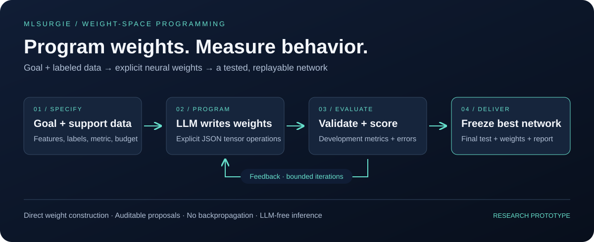

<div align="center">

# MLSurgie

### Weight-space programming, benchmarked against classical ML

**Give an agent a goal, data and a computer. It writes the network's weights. Compare it with random forests and SVMs on the same split.**

[](https://github.com/elharchaoui/MLSurgie/actions/workflows/tests.yml)
[](pyproject.toml)
[](https://pytorch.org/)
[](#current-scope)

[Benchmark](docs/benchmark.md) · [Agent harness](docs/agent-harness.md) · [Quickstart](docs/quickstart.md) · [LLM providers](docs/providers.md) · [Technical reference](docs/reference.md) · [Titanic evidence](experiments/titanic/RESULTS.md) · [Contribute](CONTRIBUTING.md)

</div>



**Weight-space programming** builds a neural network without training it. An LLM agent studies the data, reasons about mechanisms, and writes every weight and bias explicitly. MLSurgie is the framework for doing this as an experiment you can measure:

- **A free agent.** The agent gets a goal, labeled support data as files, a sandboxed computer (Python or shell), a persistent workspace for the tools it writes itself, and a playbook of [weight-space programming skills](src/mlsurgie/skills/README.md). There are no prebuilt construction scripts.
- **A checked deliverable.** Whatever the agent does, it delivers one thing: a JSON **weight program**. That program is validated, hashed, evaluated in a separate process, frozen, and replayable without the LLM.
- **A protocol with declared variables.** Budget, feedback policy, selection rule and track (semantic or anonymized feature names; strict or open fitting policy) are explicit and recorded.
- **A benchmark against classical ML.** Fraud detection, diagnosis, multiclass, regression, clustering and model repair. Each is compared with logistic regression, random forests, SVMs or k-means, plus a non-LLM search control, on **the identical split and inputs**.

The framework never fits weights: there is no backpropagation, gradient descent or estimator fitting in the construction loop. Revisions driven by development feedback are still adaptive model selection, and the docs say so.

## Start here

| Your goal | Start with |
|---|---|
| Try the pipeline offline, with no model or credentials | [Offline demo](#quickstart) |
| Benchmark an agent against random forests, SVMs and k-means | [Benchmark](docs/benchmark.md) |
| Give a coding agent data, tools and skills to write weights | [Agent harness](docs/agent-harness.md) |
| Choose a local or hosted LLM | [Provider setup](docs/providers.md) |
| Understand the weight language and artifacts | [Technical reference](docs/reference.md) |
| Inspect measured LLM construction experiments | [Titanic protocol and results](experiments/titanic/RESULTS.md) |
| Add a task, an editor or a skill | [Contributing guide](CONTRIBUTING.md) |

## Quickstart

Requires **Python 3.11+** and a compatible PyTorch wheel; CI uses Python 3.12.

```bash
git clone https://github.com/elharchaoui/MLSurgie.git
cd MLSurgie
python3.12 -m venv .venv
source .venv/bin/activate
python -m pip install -e '.[baselines]'

mlsurgie demo --output runs/first-demo          # scripted known-rule fixture: x > 0
mlsurgie replay runs/first-demo                 # rebuild the network from its programs
mlsurgie bench --seeds 0 --output runs/bench    # trained baselines on all six benchmark tasks
```

The demo is a **scripted fixture**, not LLM reasoning. It checks the whole proposal → selection → export → replay path. Use a new output directory for every run.

## Benchmark an agent

```bash
python -m pip install -e '.[harness,baselines]'   # harness needs Python 3.12+
docker build -f containers/Dockerfile.constructor -t mlsurgie-constructor:local .
export OPENROUTER_API_KEY="YOUR_API_KEY"

mlsurgie bench --editor agent --model openrouter/YOUR_VENDOR/YOUR_MODEL --output runs/bench-agent
mlsurgie bench --editor agent --model openrouter/YOUR_VENDOR/YOUR_MODEL --names anonymized --output runs/bench-agent-anon
mlsurgie bench --editor random-search --output runs/bench-search   # non-LLM control, free
```

| Task | Type | What the agent must do |
|---|---|---|
| `fraud` | binary, 2% positives | Find conjunctive fraud scenarios in 12k synthetic transactions; ranked by average precision |
| `breast_cancer` | binary | Combine many correlated measurements into calibrated evidence |
| `wine` | multiclass | Build per-class logits or prototypes |
| `diabetes` | regression | Build an additive numeric response in target units |
| `segments` | clustering | Find 4 customer segments without labels; scored by ARI against hidden ground truth |
| `segments_repair` | repair | Diagnose and patch a deployed network with two planted faults |

Each run writes `results.md`: the agent against every baseline, mean ± sd over seeds, with model size in stored numbers. Live runs cost provider tokens, bounded per cell by the task budget. Start with `--seeds 0` and a single-task suite. [Protocol, tracks, controls and how to read results →](docs/benchmark.md)

For the lightweight path without a coding agent, `mlsurgie build --config benchmarks/tasks/wine.json --openrouter-model VENDOR/MODEL --output runs/x` asks a JSON-only LLM for weight programs directly. Ollama is also supported. There is **no default model**. [Providers →](docs/providers.md)

## How weight-space programming works

1. **Specify the task.** Goal, task type, features, selection metric and budget. MLSurgie splits the data into support, development and test, and fits preprocessing on support only.
2. **Construct.** The editor (an agent, a JSON LLM, or a control) reads the support data and writes a weight program.
3. **Measure and revise.** MLSurgie validates the program and scores it on development rows in a separate process. The editor gets back only what the declared feedback policy allows.
4. **Freeze and deliver.** The best candidate is frozen before the test rows are opened once. The export includes weights, preprocessing, every program, tensor diffs, checksums, audit flags and metrics.

```json
{
  "base": "zero",
  "hidden_sizes": [2],
  "activations": ["relu"],
  "rationale": "Represent positive and negative evidence with two ReLU units.",
  "operations": [
    {"op": "set", "tensor": "layers.0.weight", "value": [[1, 0], [-1, 0]]},
    {"op": "set", "tensor": "layers.1.weight", "value": [[4, -4]]}
  ]
}
```

Editors can `fill`, `set`, `set_entries` or `add_entries`, and can patch the current best by its exact hash. [Weight-program semantics →](docs/reference.md#weight-programs)

## Evidence so far

### Fraud benchmark: live Opus 5.5 agent

With the free-agent harness, `anthropic/claude-opus-5.5` profiled the support data, wrote its own tools, and built a 265-parameter network of soft-step detectors and AND units encoding three fraud signatures. That was one candidate on seed 0, with no audit flags. [Full record and caveats →](experiments/fraud/opus55-live/README.md)

| Final test (2,401 txns) | Avg. precision ↑ | ROC-AUC ↑ | Log loss ↓ | Stored numbers |
|---|---:|---:|---:|---:|
| **Opus 5.5 agent, written weights** | 0.746 | 0.886 | **0.037** | 265 |
| Logistic regression | 0.668 | **0.897** | 0.051 | 28 |
| Random forest | **0.780** | 0.875 | 0.049 | 129,708 |
| RBF SVM | 0.721 | 0.817 | 0.046 | 8,961 |

Caveat: a skill file available during this run hinted at fraud patterns that overlap with the planted scenarios. It has since been neutralized; a clean multi-seed rerun and the anonymized track are the next step.

### Five more tasks: live GPT-6 Astra agent

`openai/gpt-6-astra` ran on every other suite task: seed 0, strict track, 140k tokens per task, $3.72 in total, no audit flags. [Full record and caveats →](experiments/benchmark/astra-seed0/README.md)

| Task (final test) | Metric | Astra network | Best trained baseline | Outcome |
|---|---|---:|---:|---|
| breast_cancer | log loss ↓ | 0.137 | LR 0.080 | Loses to LR and SVM; ties random forest |
| wine | log loss ↓ | **0.0075** | LR 0.026 | Best; one feedback-driven revision |
| diabetes | RMSE ↓ | 57.85 | RF 54.15 | Behind trained models (ridge 56.87) |
| segments | ARI ↑ | 0.981 | GMM 1.000 | Ties k-means |
| segments_repair | ARI ↑ | 0.383 → 0.981 | GMM 1.000 | Found 2 of 3 planted faults; 2-value patch |

Written weights are **competitive but not dominant**. They win where explicit prototypes fit (wine log loss) and lose where a learned smooth boundary helps (breast cancer, diabetes). Most tasks got one candidate per budget, on one seed and on familiar public data, so this is a first measurement, not a ranking.

### Titanic

Two LLM-constructed networks, each frozen before the test set was opened, compared with trained baselines on the **same seed-42 split and the same 22 encoded inputs** (179 test passengers):

| Predictor | Accuracy | ROC-AUC | Log loss ↓ | Stored numbers |
|---|---:|---:|---:|---:|
| Logistic regression | 75.98% | 0.8437 | 0.4720 | 23 |
| Random forest | 78.21% | 0.8410 | 0.4753 | 52,764 |
| RBF SVM | **81.01%** | 0.8115 | 0.4828 | 5,406 |
| Interactive assistant, 8 revisions | 80.45% | 0.8398 | **0.4455** | 769 |
| Opus 5.5 OpenHands agent, 1 candidate | 79.89% | **0.8439** | 0.4551 | 337 |

The hand-written networks are **competitive with standard trained models** on this split. They have the best log loss and match logistic regression on AUC, while the SVM has the best accuracy. That's one public dataset, which the LLMs have likely seen, and one split; accuracy intervals are about ±6 points. The [Opus run](experiments/titanic/opus55/README.md) and the [interactive run](experiments/titanic/RESULTS.md) document methods, sources and limits, and both replay from the tracked artifacts.

The multi-task suite above is the next evidence step: uncontaminated synthetic tasks, multiple seeds, and the anonymized track.

## Current scope

| Supported in v0.2 | Details |
|---|---|
| Tasks | Binary (including imbalanced), multiclass, regression, clustering; repair from a provided network |
| Networks | Feed-forward; Linear plus `relu` / `tanh` / `sigmoid` / `identity` per hidden layer; task-specific output head |
| Editors | OpenHands coding agent (Docker sandbox, persistent workspace, skills); Ollama and OpenRouter JSON editors; random-search control; scripted fixtures |
| Protocol | Declared `Budget`, `FeedbackPolicy`, `SelectionRule` and `Track`; static fitting audit; sealed final test |
| Benchmark | Six tasks, trained baselines, suite runner, mean ± sd across seeds |
| Reproducibility | Saved programs, tensor diffs, dataset fingerprints, split indices, checksum-verified loading and replay |

Not yet supported: additive or scorecard model families, custom layers, user-supplied separate test sets. Run folders contain data examples, so review them before sharing. [Full constraints and trust model →](docs/reference.md#inputs-and-supported-scope)

## Use the exported network

```python
from mlsurgie import load

predictor = load("runs/first-demo")
print(predictor.predict_proba([{"x": 0.7}, {"x": -0.7}]))   # classification
print(predictor.predict([{"x": 0.7}]))                      # labels, values, or cluster ids
```

```bash
mlsurgie predict runs/my-run --dataset data/new-rows.csv --output predictions.csv
```

## Questions

**Is the agent constrained by MLSurgie's scripts?** No. It writes its own analysis code, forward pass, metrics and construction code, and keeps them in `/workspace`. MLSurgie controls only what data it can see and what it delivers.

**How do you know it didn't just fit a model?** The rules are stated in the agent's instructions and in `skills/policy.md`. Every executed source and workspace file is statically audited for learning libraries, solvers, gradient updates and `.fit(` calls; on the strict track, flagged candidates are rejected. The audit is a tripwire, not a proof, so all sources are retained for review.

**Is this training-free?** It uses no gradients or estimator fitting. It does use labeled support data and repeated development feedback, which is adaptive optimization by another name. The random-search control measures how much of a result evaluation-guided search alone would produce.

**Does memorized knowledge inflate results?** It might on familiar datasets. Use `--names anonymized` and the synthetic tasks to measure that.

## Research and community

Inspired by [Weight Space Programming](https://rikiyat.github.io/blog/weight-space-programming/). MLSurgie is an independent implementation for tabular machine learning. See the [research dossier](docs/weight-space-research.md); earlier design notes are in [docs/archive](docs/archive/).

Contributions are welcome: benchmark tasks with planted structure, skills, editor adapters, and reproducible failures. Follow [CONTRIBUTING.md](CONTRIBUTING.md). Omit private data and credentials from issues.

Maintained by [@elharchaoui](https://github.com/elharchaoui). Licensing terms have not yet been specified; a license decision is needed before treating this as permissively licensed software.
