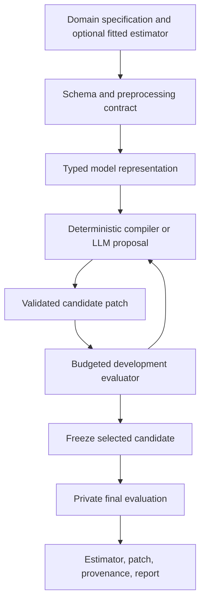

# MLSurgie: proposed framework plan

Status: design proposal based on the public-source research completed on 4 November 2026. The API below is illustrative and is not implemented. Timelines and acceptance criteria are proposed engineering targets, not measured performance.

## Product decision

Build a Python framework that turns domain knowledge and diagnosed failures into explicit, testable changes to classical ML models. Start with interpretable tabular regression and classification. Offer both construction from a specification and repair of an existing fitted estimator.

The initial promise: **describe a model's intended behavior, construct or patch its parameters, and receive a deployable estimator with evidence showing what changed.**

Direct neural weight programming is one backend. Native classical parameter editing is another, explicitly labeled as a broader extension of the paper's idea. A tree split or additive term is not an ordinary neural weight. Keep this distinction in documentation and results.

The research basis and community examples are in [weight-space-research.md](weight-space-research.md).

## Intended users and first workflows

| User need | First workflow | Result |
|---|---|---|
| Encode a known response curve | Compile named piecewise-linear effects into an additive predictor | Inspectable model with numerical equivalence checks |
| Correct a localized predictor fault | Inspect coefficients, term curves, or MLP units and propose a bounded patch | Candidate estimator, patch, before/after report |
| Combine knowledge with limited labels | Compile a prior model, then fit only explicitly editable parameters | Hybrid model with construction and fitting provenance |
| Apply an operating policy | Change a decision threshold or rule | Policy change recorded separately from model learning |

For example, a synthetic demand predictor might require demand to decrease with price and increase with promotion. A domain specification can define the intended shape, while observations determine its magnitude. Separate those two sources of information. A natural-language request alone does not justify invented coefficients.

## Execution modes

Every run records one of these modes:

1. `compile`: no labeled fitting; a typed specification deterministically produces parameters. An LLM may propose the specification or a construction program.
2. `edit`: parameter inspection and a stated probe budget; no optimizer or regression fitting. Adaptive selection of edits is recorded as such.
3. `hybrid`: construction/editing plus explicitly allowed fitting, calibration, or refinement. Record each operation and the data it used.

Within each mode, declare whether raw tensors, feature meanings, examples, predictions, activations, or aggregate metrics are visible. “No gradients” is a procedural property, not a claim that the system used no data or performed no search.

## Model support in priority order

| Family | Parameter representation | Initial supported operations | Priority |
|---|---|---|---|
| Linear/logistic regression | Named coefficients, intercept, class order | Inspect, construct, bounded coefficient/intercept patches | MVP |
| Framework-owned additive predictor | Knots, per-feature values/slopes, link | Compile piecewise-linear effects, enforce supported shape constraints | MVP |
| InterpretML EBM | Bin metadata, term scores, interactions, link | Import and controlled term edits | First extension |
| Small dense MLP | Graph, tensors, activations, feature schema | Inspect, sparse patch, compile a small primitive subset | Research extension |
| Decision trees | Feature indices, thresholds, topology, leaves | Inspect and leaf edits first | Later |
| Random forest/boosting | Native tree structures, objectives, base score | Narrow adapter-specific patches | Later |
| Kernels, clustering, forecasting | Family-specific structures | Design after tabular evidence | Deferred |

Prefer a framework-owned additive model initially to constructing partially initialized third-party estimator internals. Linear-model adapters must preserve fitted-state metadata. Import support, editable support, and export support are separate capability flags.

Never average arbitrary models or blindly mutate a tree tensor export. A small parameter change can redirect many observations. Imported model semantics take priority over a uniform tensor interface. Hummingbird is a possible later deployment integration, not a universal editing abstraction. [Hummingbird](https://github.com/microsoft/hummingbird)

## Architecture



### 1. Schema and preprocessing contract

Capture feature names, types, units, ranges, missing-value semantics, category maps, transformations, target link, and class order. Freeze fitted preprocessing with the model. Express requests in original feature units and lower them into transformed coordinates explicitly.

For a standardized linear model with z_j = (x_j - mu_j)/s_j, a desired raw coefficient a_j maps to w_j = a_j s_j and transformed intercept b = a_0 + sum(a_j mu_j). This conversion prevents a common class of incorrect edits. Test it against predictions in raw coordinates.

### 2. Typed intermediate representation

Create `ModelIR` with graph structure and semantic parameters: `LinearTerm`, `PiecewiseLinearTerm`, `InteractionTerm`, `DenseLayer`, and later `TreeNode`. Attach ranges and units. Keep source-estimator mappings so each change can be traced back to its native representation.

Represent preprocessing and the output link as part of the prediction contract. An editable array without its semantics is insufficient. Architecture changes should be separate operations with separate validation.

### 3. Compiler and primitive library

Implement deterministic affine and piecewise-linear constructions first. Example identity: clip(x, 0, 1) = ReLU(x) - ReLU(x - 1). An LLM can choose and compose such primitives, while the compiler handles exact parameter assignments.

Comparisons and gates require explicit semantics. A continuous finite ReLU network cannot implement an exact discontinuous threshold over all real inputs. Use a native comparison operator or specify a margin and approximation tolerance. Track dtype, overflow, supported input domain, and boundary behavior. Draw inspiration from [Tracr](https://github.com/google-deepmind/tracr) and [torchwright](https://github.com/physicsrob/torchwright), without requiring transformer output.

### 4. Parameter patch protocol

Each patch contains a base-model hash, schema/preprocessing hash, adapter version, target selectors, old/new values or factors, preconditions, and intended effect. Include a rationale and a required verification probe. Reject shape errors, nonfinite values, stale bases, and unsupported fields.

Apply to a copy and return a candidate; do not mutate the user's model by default. Provide exact reversal and deterministic replay. Hash the final serialized artifact as well as the source parameters. Track buffer constants and all persistent state, not only `requires_grad` tensors.

### 5. Inspector and editor

Begin with deterministic inspection: coefficient tables, additive curves, feature contributions, output biases, saturation summaries, and model-specific anomalies. Add LLM access to compact summaries and requested slices rather than entire large tensor dumps.

Use a pluggable `EditorBackend` for hosted or local models. Validate structured operations before executing them. For exploratory code generation, use an isolated worker with explicit file/data access and resource limits. This is necessary for reproducible experiments as well as containment. Do not treat an in-process Python namespace as an enforced boundary.

Evaluate [weightspace](https://github.com/leofmarciano/weightspace) as an optional tensor backend. Reuse only after checking patch semantics, isolation, reproducibility, and dependency compatibility; keep classical adapters and the evaluator independent.

### 6. Evaluation and acceptance

Keep training, editor-visible development, candidate-selection validation, and final test roles explicit. In small-data settings use nested cross-validation rather than impractical fixed four-way splits. The editor must never read final test examples or labels. Freeze the candidate before the private test report is generated.

Every feedback-bearing observation is metered. Record calls, rows evaluated, model invocations, samples/rollouts, generated tokens where relevant, wall time, memory, editor tokens, and provider cost. Ten probes on 10,000 rows are not comparable to ten single-example probes.

An acceptance rule combines a primary metric, a noninferiority allowance for preserved behaviors, and required constraints. Select against development/validation only. A failed final evaluation rejects that candidate; do not feed the result back into repeated editing on the same final set.

Distinguish a mathematical property guaranteed by an architecture from a property observed on probes. For example, nonnegative slopes can ensure monotonicity of a supported additive form; passing a sampled grid does not establish global monotonicity of an arbitrary interacting model.

### 7. Output and deployment

Return `candidate`, `patch`, `report`, and `provenance`. A trained/constructed estimator predicts locally without an LLM at inference time. Support native Python serialization first, with explicit versions and hashes; add ONNX only for validated adapters.

A report includes before/after metrics, subgroup results when specified, constraint checks, changes outside the requested region, cost, failures, and uncertainty. Provenance distinguishes specification-derived, data-fitted, and editor-proposed parameters. An LLM explanation is not a proof.

## Proposed API

```python
# Design sketch only: these objects do not exist yet.
from mlsurgie import ModelSpec, Feature, Constraint, compile_model, propose_edit

spec = ModelSpec(
    task="regression",
    family="additive",
    features=[Feature("price", unit="EUR", bounds=(0, 200))],
    constraints=[Constraint.monotone("price", direction="decreasing")],
    # A known curve can be supplied here; otherwise magnitudes require data.
)

prior = compile_model(spec, curves={"price": [(0, 100), (200, 0)]})
result = propose_edit(
    estimator=fitted_model,
    request="Repair the increasing price effect above EUR 150.",
    schema=feature_schema,
    development=(X_dev, y_dev),
    budget={"probe_calls": 10, "evaluated_rows": 20_000},
    mode="edit",
)
candidate = result.candidate  # original remains available
predictions = candidate.predict(X_new)
result.save("runs/price-repair")
```

Implement sklearn estimator conventions (`fit`, `predict`, `predict_proba` where relevant, `get_params`, `set_params`, clone/pipeline compatibility). `compile_model` makes construction explicit. `fit` always discloses whether it performs numerical fitting or delegates to another estimator. The private evaluator is an external benchmark component and is never passed to the editor.

## Benchmark: three distinct questions

### A. Can it construct the intended function?

Use private generated functions with randomized feature names, units, slopes, knot locations, and category codes. Include affine functions, monotone splines, capped responses, and a small interaction family. Check function equivalence or error bounds on supported domains, including knots, missing cases, and range boundaries.

Compare direct LLM parameter writing, LLM-to-IR plus compiler, deterministic compiler with the full specification, and ordinary fitted estimators at several sample sizes. If the complete function is supplied, the compiler baseline is essential: this is compilation success, not discovery of an unknown law.

### B. Can it repair a localized defect?

Create planted cases: incorrect intercept, output-class suppression, unit scaling, one corrupted additive region, and a missing-category effect. Then add naturally occurring failures on fresh datasets. Keep fault-generation seeds and exact corruption locations hidden from the editor.

Compare the original, a deterministic known-fault repair where available, calibration/threshold adjustment, conventional refitting, constrained refitting, random patches matched by magnitude/sparsity, and a coding agent with the same observations. A repair should improve targeted behavior and preserve unrelated performance.

### C. Does it help real predictive modeling?

Start with roughly 10 diverse classification/regression datasets; broaden only after a demonstrated benefit. Measure small-data learning curves, schema semantics on/off, domain priors on/off, two or more editors, and multiple independent edit seeds. Use temporal or grouped splits where the task requires them.

Baselines: regularized linear/logistic regression, EBM, CatBoost or LightGBM/XGBoost, matched small MLP, HyperFast for applicable classification tasks, and a pinned TabPFN checkpoint. Include ordinary calibration; it is an established fitted method, not a new WSP invention. [Calibration documentation](https://scikit-learn.org/stable/modules/calibration.html)

Use [TabArena](https://github.com/autogluon/tabarena) protocols for the broader evaluation, then beyond-IID tasks. Do not claim current leaderboard superiority from a small handpicked subset. Confirm dataset/pretrained-checkpoint overlap and use fresh private tasks for stronger contamination controls.

### Reporting and ablations

- Classification: log loss, ROC-AUC/PR-AUC as appropriate, Brier score, accuracy, class-level recall.
- Regression: MAE/RMSE, scale-normalized error, and domain-specific loss when predeclared.
- All tasks: constraint violations, locality of changes, failure rate, cost and latency; calibration separately from discrimination.
- Compare matched wall-clock/cost budgets and also report performance-versus-budget curves. Include model construction, upstream pretrained components, and editor costs in the accounting.
- Use paired uncertainty estimates at the dataset/task level. Multiple stochastic generations of one example are not independent datasets.
- Test hidden-unit permutations, feature reorderings with correct schema remapping, shuffled tensors, and unseen schema encodings. Report every attempted run.

## Delivery sequence and decision gates

Estimated scope: two experienced ML engineers over roughly eight weeks, plus occasional domain review. One engineer should reduce scope or extend the schedule. Costs depend on the selected editor and experiment volume; set hard budgets before remote runs.

| Stage | Timing | Deliverables | Gate |
|---|---|---|---|
| Feasibility | Week 1 | Minimal model IR, one construction and one fresh-data repair; editor versus deterministic baseline | Confirm at least one plausible advantage worth measuring |
| Deterministic core | Weeks 2–3 | Schema, linear/additive models, compiler, patch/replay, private evaluation scaffold | Numerical correctness; original preserved; replay reconstructs candidate |
| Editor integration | Weeks 4–5 | Structured inspection/editing, provider interface, budgets; EBM import/edit if core holds | Reliable valid proposals and full cost/failure logs |
| Classical evidence | Weeks 6–7 | Planted and natural failures, initial tabular suite, ablations | Benefit survives fresh splits and strong cheap baselines |
| Alpha release | Week 8 | Examples, documentation, pinned environments, benchmark results and limitations | Reproducible benefit in at least one clearly defined use case |

Suggested predeclared feasibility targets: at least 95% numerical conformance for the supported construction suite, and recovery of at least 80% of planted faults with no more than one percentage point classification-accuracy regression on preservation cases. These are provisional targets to refine before running experiments; planted-fault success alone is insufficient for a product claim.

For real-data adoption, require a repeatable benefit in at least one axis—prediction quality, constraint satisfaction, repair cost, or time to an interpretable model—against the strongest applicable baseline, with its tradeoffs reported. Do not require or promise universal accuracy superiority.

If LLM edits cannot beat simple deterministic repair or refitting, retain the compiler, model inspection, and reproducible patching components, and narrow the editor's role to specification assistance. If construction adds no value over native rules, provide the native model directly. A tensor artifact should serve deployment or composition, rather than exist only to resemble the paper.

## Initial examples and package layout

Ship three examples first: compile a known additive response curve, repair a corrupted linear/logistic model with a fresh private test, and edit an additive region while checking preserved behavior. Add small-MLP rule compilation as a research example after these pass.

```text
src/mlsurgie/
  schema/         # types, units, preprocessing and output contracts
  ir/             # typed parameter and graph representation
  adapters/       # native estimator import/export and capability flags
  compiler/       # validated constructions and numerical domains
  patches/        # transactional writes, hashes, inversion and replay
  inspect/        # deterministic summaries and probes
  editors/        # structured proposal interfaces and provider adapters
  evaluation/     # development probes, constraints and cost accounting
  reporting/      # artifacts and provenance
benchmarks/       # separate private evaluator interface and protocols
examples/
```

The first implementation milestone is a complete vertical slice: **domain specification → additive parameters → estimator → verified patch → fresh evaluation → replayable report**. That establishes the framework's classical ML purpose before adding broad model support.
