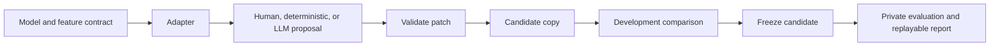

# MLSurgie: revised framework and adoption plan

Version 2 — 4 November 2026. Supersedes [version 1](framework-plan-v1.md). This is a design proposal, not an implemented API or a claim of measured performance. See the [research dossier](weight-space-research.md) for evidence and community projects.

## Product decision

Build a small Python library for domain-guided parameter editing of tabular models. Its promise: take an existing model and an explicit behavioral requirement, propose a bounded parameter change, and show whether it helped on fresh data. Return an ordinary deployable estimator, a reversible patch, and a reproducible report.

The first practical users are people maintaining interpretable predictors. The first research users are people comparing direct LLM weight proposals. Model construction follows through parameter initialization and optional fitting, using the same evaluation infrastructure.

Adoption remains a hypothesis. Interest in the paper does not establish demand for a framework.

## Corrections to the original plan

| Original weakness | Revision |
|---|---|
| Compiler, custom estimator, universal IR, agent, and benchmark in one MVP | One editing workflow and a small patch schema |
| New additive estimator increases migration and maintenance | Integrate existing estimators first |
| Neural models deferred, weakening the WSP connection | Include one tightly specified MLP research adapter |
| Planted defects dominate examples | Require a naturally occurring failure before practical claims |
| No-fitting restriction controls product design | Apply restrictions to research protocols; disclose fitting in practical mode |
| 95% compiler correctness proposed as acceptable | All supported deterministic constructions must pass contract checks |
| Broad roadmap precedes user validation | External use and stage gates determine expansion |
| Adoption barely specified | Offline onboarding, independent replay, small contributions, maintenance policy |

InterpretML already supports term editing and monotonicity operations. Wrapping those alone is insufficient differentiation. Our contribution must be task contracts, comparisons, replay, and reports across supported models. [InterpretML documentation](https://interpret.ml/docs/faq.html)

## First useful workflow

Repair an unwanted feature response while preserving predictive quality. Example: a domain expert requires decreasing demand with increasing price over a specified range, while a fitted model violates that requirement.

The user supplies the requirement; MLSurgie does not infer causal laws from column names. Price and demand can be confounded. A surprising curve is not automatically a bug.

The demonstration must show the original model, structured requirement, deterministic and optional LLM proposals, comparison against native operations and constrained refitting, and one final evaluation of the frozen candidate. Report changes outside the requested region as well as targeted improvements.

For additive models without relevant interactions, a feature term can be edited directly. For MLPs, monotonicity checks over sampled contexts are empirical observations. A partial-dependence curve alone cannot establish individual-level or global monotonicity.

## Minimum scope

| Adapter | Initial scope | Purpose |
|---|---|---|
| sklearn linear/logistic | Dense numeric inputs, coefficients and intercept, explicit class order | Correctness baseline |
| InterpretML EBM | Regression and binary classification; numeric main effects without interactions involving edited features | Practical first integration |
| PyTorch MLP | Fixed Linear/ReLU architecture; bounded tensor slices | Direct WSP research |

Publish these incrementally. Unsupported categorical handling, transformations, interactions, and architectures fail explicitly. Do not advertise arbitrary Pipeline compatibility. Freeze and fingerprint supported preprocessing alongside the model.

Initial operations: set/add a coefficient or intercept, replace a bounded additive-term region, and set/add a tensor slice. More complicated changes are compositions. Add low-rank operations only when an experiment needs them.

Defer universal graph IR, a custom estimator family, tree ensembles, merging, AutoML, hosted services, and dashboards. A notebook and standalone report are sufficient initially.

## Architecture



Three extension points are enough:

- Adapter: expose supported parameters, snapshot state, apply to a copy, predict, validate compatibility.
- Proposer: return a structured patch from the requirement and allowed observations.
- Check: evaluate a requirement and state whether it is exact, numerically checked, or sampled.

Keep evaluation outside the proposer. An LLM produces structured operations, not unrestricted code in the core workflow. Validate selectors, bounds, shapes, dtype, finite values, and old-value preconditions before mutation. This avoids making a general agent sandbox a prerequisite.

A patch contains a canonical model-state fingerprint, schema/preprocessing identity, library versions, old/new values, intended effect, and verification requirements. Arrays and JSON metadata should be replayable without executing proposal code. Native model loading retains its framework's trust requirements.

Preserve an immutable baseline. Exact reversal applies to the corresponding state, not arbitrary versions or models. Canonical state fingerprints are more appropriate than assuming pickle byte hashes are stable across versions. Recompute or invalidate derived metadata, including uncertainty summaries affected by editing.

## User experience

Illustrative API only:

```python
session = surgery.open(model, schema=schema)
proposal = session.propose(
    requirement=Monotone("price", direction="decreasing", domain=(50, 150)),
    proposer="deterministic",  # no API key
)
comparison = session.compare(
    proposals=[proposal], data=(X_dev, y_dev), checks=checks,
)
candidate = comparison.select(policy=acceptance_policy)
candidate.save("runs/price-edit")
predictions = candidate.model.predict(X_new)
```

Selecting no change is valid. Reports distinguish invalid, rejected, inconclusive, and accepted proposals. Predictions never call an LLM.

An optional LLM proposer translates a request into a visible structured requirement and patch. Missing essential domain information produces an unresolved proposal rather than invented coefficients. Callers can inspect proposals or automate selection under explicit policies.

Return native estimators where possible. Any introduced wrapper must satisfy sklearn estimator checks, cloning, and relevant pipeline/cross-validation behavior. [sklearn developer guide](https://scikit-learn.org/stable/developers/develop.html)

## Building models remains a core objective

After editing works, add initialization from specifications for linear and small ReLU networks. Support affine terms, piecewise-linear curves, and bounded compositions. A deterministic primitive library writes weights; an optional LLM chooses a specification or directly proposes weights.

Compare direct LLM writing, LLM-to-specification compilation, and ordinary fitting. Permit an explicit subsequent fit stage with selected parameters frozen. The research question is whether domain-informed parameters improve sample efficiency or behavior in sparsely observed regions.

Keep parameter provenance: specification-derived, data-fitted, or editor-proposed. Numerical magnitudes missing from the specification require observations or declared priors. Model construction should not manufacture knowledge about an unknown process.

## Evidence and evaluation

Maintain two distinct tracks:

1. Practical: all declared methods allowed, including fitting. Measure predictive quality, constraints, cost, time, and user effort.
2. WSP research: pin architecture, visible information, operations, examples evaluated, and budgets. Record gradients, fitting, feedback, and data exposure independently.

Synthetic cases establish numerical correctness and known fault localization. Real datasets and natural failures establish practical relevance. Freeze splits, requirements, baseline budgets, and acceptance tolerances before editing. Use temporal or grouped splits where required. A final test that informs future changes is no longer fresh for subsequent claims.

Initial baselines: no change, native monotonicity operation, constrained refit, ordinary refit, optional LLM patch. Include calibration when probability quality is the target. Use boosted trees or TabPFN for end-to-end predictive comparisons rather than irrelevant replay comparisons.

Report all attempts, uncertainty, effect sizes, constraint violations, changes outside the target region, and full editing costs. Count evaluated rows and model calls, not only probe requests. A known-location planted repair is a wiring test. Include randomized feature encodings and behavior-preserving hidden-unit permutations to test superficial cues.

Use MAE/RMSE for regression and suitable discrimination/probability metrics for classification. Constraint tolerance and preservation tolerance come from the task, not a universal one-percentage-point rule. Exact supported constructions must meet their contracts; sampled tests must not be described as proofs.

## Community adoption

First ten minutes: install, run a CPU-only example, inspect a meaningful before/after report, save and replay the edit. No account or API key. Scripted proposal fixtures keep CI offline and must be clearly labeled as fixtures, alongside optional live examples.

First external users: recruit three to five practitioners with fitted tabular models and one concrete requirement each. Observe completion without maintainer intervention and repeat use on another model. These are future outreach activities; no outreach has been performed.

Small contribution paths:

- A failure case: dataset provenance, schema, split recipe, estimator recipe, requirement, baseline, and checks.
- A proposer: same task/observation contract, returning the standard patch.
- A check: documented exact or sampled semantics.
- An adapter only when an actual new estimator family is needed.

Publish runnable manifests, negative results, failed runs, pinned versions, and cost records. Start with reproducible reports; add a leaderboard only after independent reproduction.

Propose Apache-2.0 for original code, checking dependency/example licenses before distribution. Publish supported versions, semantic versioning, changelog, deprecation policy, and adapter conformance tests. Keep provider dependencies optional. Core tests run offline; live tests are explicitly budgeted.

Evaluate reuse of weightspace for tensor tooling and InterpretML for native operations. Own the task contracts, patch interoperability, comparisons, and reports. Do not claim novelty for established calibration or projection algorithms.

Measure successful installs, independent replay, repeat use, external case contributions, and adapter maintenance effort. Stars measure attention, not usefulness.

## Stage gates

| Increment | Deliverable | Continue when |
|---|---|---|
| 0 | Three realistic cases, one natural failure, native baselines | Users need more than an existing one-line operation |
| 1 | Linear/EBM patches, offline report and replay | Contract tests pass; new users complete the workflow |
| 2 | One MLP architecture and optional structured LLM proposer | Budgets and failure accounting are enforced |
| 3 | External alpha and contribution templates | Independent reproduction and repeat use occur |
| 4 | Specification-driven initialization and optional fitting | A predeclared sample-efficiency or behavioral benefit is demonstrated |

Planning estimate: two weeks for a core spike and four to six further weeks for an external alpha with two experienced contributors. Scope and evidence determine release timing.

If users only need native EBM methods, contribute helpers upstream. If LLM editing adds no value, retain it as experimental. If neither practitioners nor researchers reuse the workflow, revisit the problem before adding adapters.

The next implementation task is one complete editing example with a strong native baseline and fresh evaluation. It makes usefulness observable before the architecture becomes expensive to change.
